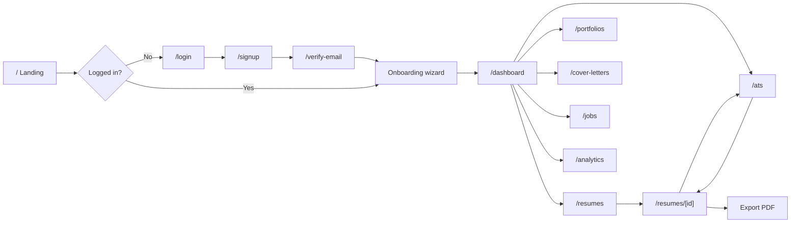
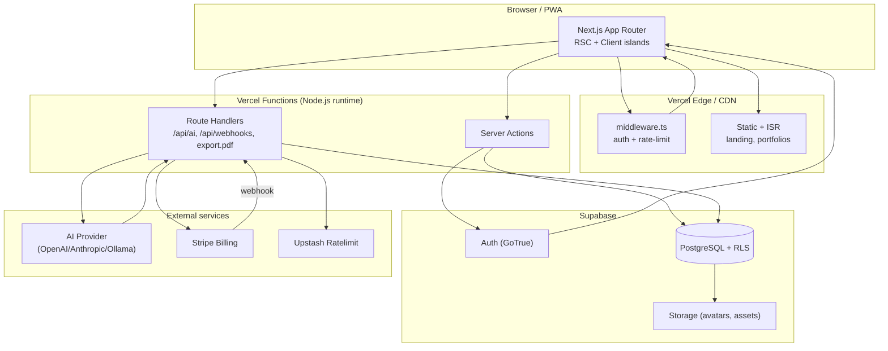
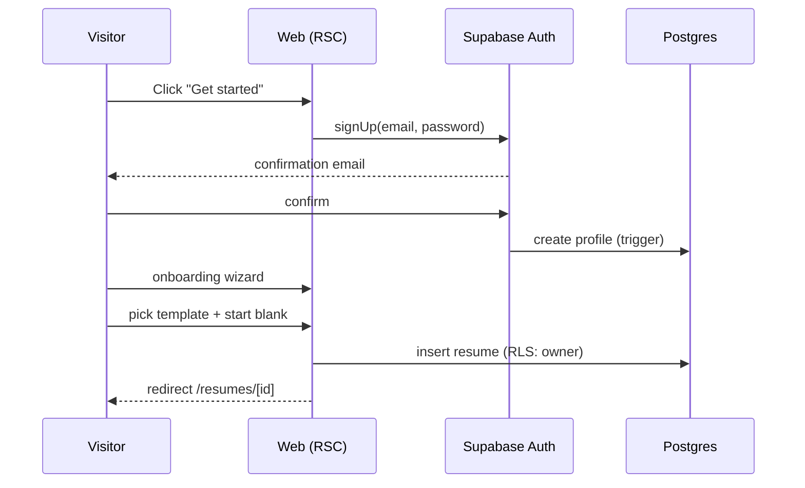
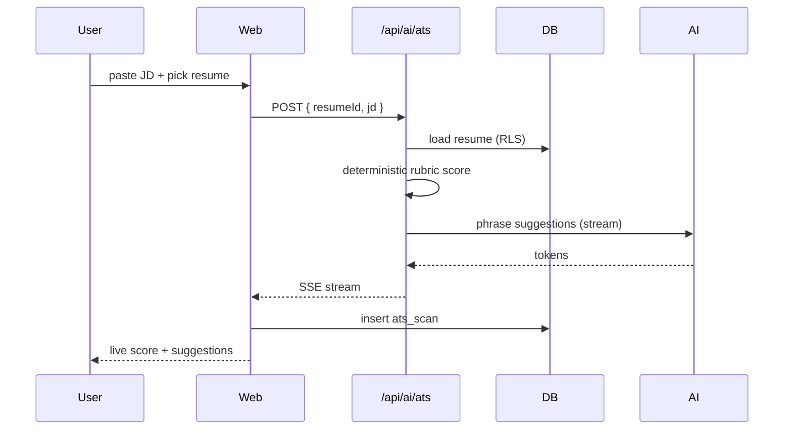
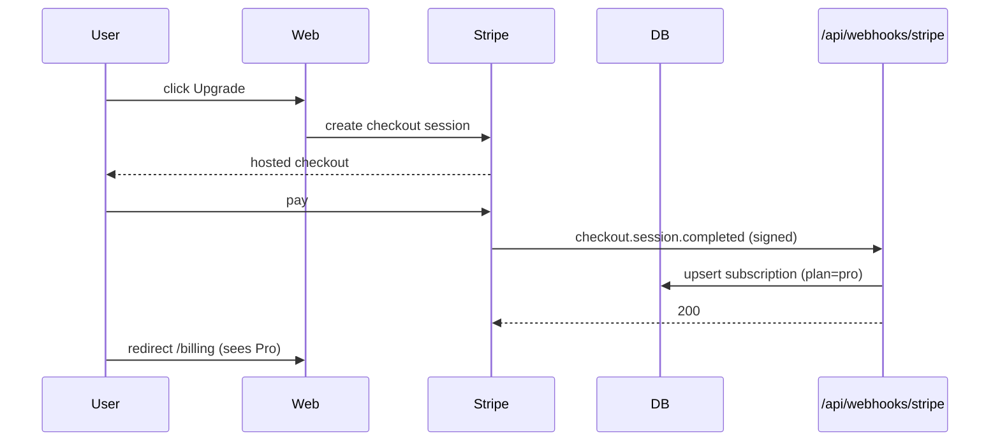

# ResumeOS — Product Requirements Document (PRD)

> **Build. Optimize. Get Hired.**
> An AI-powered, open-source career platform for resumes, ATS-friendly CVs, AI cover letters, portfolio websites, and job tracking — from one unified dashboard.

| Field | Value |
| --- | --- |
| Document owner | Istiak Rahman |
| Status | Draft v1.0 — Production-ready specification |
| License | MIT |
| Target deployment | Vercel (primary) + Docker (self-host) |
| Repository visibility | Public / Open Source |
| Target stack (installed) | Next.js 16.2.10, React 19.2.4, TypeScript, Tailwind CSS v4, shadcn v4 (`base-nova` style on `@base-ui/react`) |
| Target stack (to add) | Supabase, PostgreSQL, Drizzle ORM, React PDF, TanStack Query, Zustand, Framer Motion, Lucide, Geist Font |

> ⚠️ **Stack reconciliation note.** The original brief specified "Next.js 15". The scaffolded environment ships **Next.js 16.2.10** with the App Router as the default, **Tailwind CSS v4** (CSS-first configuration via `@theme` in `globals.css`, no `tailwind.config.js`), and **shadcn v4** using the `base-nova` style built on **`@base-ui/react`** (not Radix UI). This PRD targets the *installed* stack. Where the brief's intent (Supabase, Drizzle, React PDF, TanStack Query, Zustand) is clear, those libraries are specified for addition. Per `AGENTS.md`, the bundled Next.js docs at `node_modules/next/dist/docs/` are the source of truth for App Router conventions and must be consulted during implementation.

---

## Table of Contents

1. [Executive Summary](#1-executive-summary)
2. [Vision, Goals & Non-Goals](#2-vision-goals--non-goals)
3. [Target Users & Personas](#3-target-users--personas)
4. [Business Model](#4-business-model)
5. [Information Architecture](#5-information-architecture)
6. [Navigation Flow](#6-navigation-flow)
7. [Feature List & Priority](#7-feature-list--priority)
8. [User Stories](#8-user-stories)
9. [Module Specifications](#9-module-specifications)
   - 9.1 Landing Page
   - 9.2 Authentication
   - 9.3 Dashboard
   - 9.4 Resume Builder
   - 9.5 Resume Templates
   - 9.6 Portfolio Builder
   - 9.7 ATS Score
   - 9.8 AI Resume Writer
   - 9.9 AI Cover Letter
   - 9.10 Export PDF
   - 9.11 Job Tracker
   - 9.12 Analytics
   - 9.13 Profile
   - 9.14 Billing
   - 9.15 Settings
   - 9.16 Admin Panel
10. [Design System](#10-design-system)
11. [Responsiveness & Breakpoints](#11-responsiveness--breakpoints)
12. [State Management Strategy](#12-state-management-strategy)
13. [Caching Strategy](#13-caching-strategy)
14. [Performance Strategy](#14-performance-strategy)
15. [Accessibility Strategy](#15-accessibility-strategy)
16. [SEO Strategy](#16-seo-strategy)
17. [Security Strategy](#17-security-strategy)
18. [Database Planning](#18-database-planning)
19. [API Planning](#19-api-planning)
20. [Authentication, Roles & Permissions](#20-authentication-roles--permissions)
21. [AI Architecture & Integrations](#21-ai-architecture--integrations)
22. [Folder Structure](#22-folder-structure)
23. [Configuration Strategy](#23-configuration-strategy)
24. [Testing Strategy](#24-testing-strategy)
25. [CI/CD & Deployment Strategy](#25-cicd--deployment-strategy)
26. [GitHub Repository Structure](#26-github-repository-structure)
27. [Documentation Structure](#27-documentation-structure)
28. [Versioning Strategy](#28-versioning-strategy)
29. [Roadmap & Future Features](#29-roadmap--future-features)
30. [Open Source Assets](#30-open-source-assets)
31. [Developer Credit](#31-developer-credit)
32. [Appendix A — System Architecture Diagram](#appendix-a--system-architecture-diagram)
33. [Appendix B — Mermaid User Flows](#appendix-b--mermaid-user-flows)
34. [Appendix C — Glossary](#appendix-c--glossary)

---

## 1. Executive Summary

ResumeOS is a commercial-grade, open-source SaaS that consolidates the entire job-search document workflow into a single premium dashboard. Instead of juggling a resume builder, a cover-letter generator, an ATS scanner, and a portfolio site across disconnected tools, ResumeOS provides one cohesive workspace where users can:

- Build pixel-perfect, ATS-compliant resumes from reusable blocks.
- Score those resumes against a target job description and receive actionable, AI-driven fixes.
- Generate AI cover letters tuned to a specific role and company.
- Publish a one-click portfolio website at `<slug>.resumeos.app` (or a custom domain on paid tiers).
- Track applications through a Kanban pipeline and view analytics on response rates, interview rates, and offer rates.

The product is positioned at the intersection of **Vercel-grade engineering quality**, **Linear-grade product polish**, and **Notion-grade content ergonomics**. It is MIT-licensed, designed to be self-hostable via Docker, and deployable to Vercel with a single environment configuration.

### Why it wins

| Axis | ResumeOS | Typical competitors |
| --- | --- | --- |
| Open source | MIT, self-hostable, auditable | Closed, vendor-locked |
| Pricing | Generous free tier, transparent paid tiers | Aggressive paywalls on export/ATS |
| Data ownership | User-owned, exportable, deletable | Vendor siloed |
| AI transparency | Shows *why* an ATS score changed | Black-box scores |
| Design system | Documented, themeable, dark/light | Inconsistent |
| Architecture | Server Components + streaming AI | Legacy SPA |

---

## 2. Vision, Goals & Non-Goals

### 2.1 Vision

Become the default open-source operating system for a job search — the place where every career document lives, evolves, and ships.

### 2.2 Goals (this release)

| # | Goal | Success metric |
| --- | --- | --- |
| G1 | Ship a production-ready open-source SaaS | Public GitHub repo, MIT license, deployable in < 10 minutes |
| G2 | Deliver the 16 core modules end-to-end | Each module has a route, schema, tests, and docs |
| G3 | Premium, mobile-first UI matching the design language of Stripe/Linear/Vercel | Lighthouse ≥ 95 on Performance, Accessibility, Best Practices, SEO for landing + dashboard |
| G4 | Real AI features (not mocked) — resume writer, cover letter, ATS scoring | AI responses streamed, rate-limited, metered per plan |
| G5 | Secure, multi-tenant data model on Supabase + Postgres | RLS enforced on every table; pen-test checklist green |
| G6 | Self-hostable parity | Docker Compose + env map produces identical behavior to Vercel deploy |

### 2.3 Non-Goals (this release)

- Not a job *board*. ResumeOS integrates with job descriptions but does not list jobs.
- Not a recruiter/CRM product. Single-user focus; team/collaboration is a roadmap item.
- Not a LinkedIn replacement. No social graph.
- Not a freelance-invoicing or contract-signing tool.
- No native mobile apps in v1 — a best-in-class responsive PWA is the target.

---

## 3. Target Users & Personas

### 3.1 Primary personas

**Persona 1 — Aisha, the new-grad CS student (22, free tier)**
- Pain: Never written a resume; doesn't know what ATS means.
- Needs: Templates, guided AI writer, free PDF export.
- Success: Submits 20 tailored applications in week one.

**Persona 2 — Marcus, the mid-career engineer switching jobs (31, Pro tier)**
- Pain: Has a 3-page resume; gets auto-rejected.
- Needs: ATS scoring, tailored resume per JD, cover letters, custom-domain portfolio.
- Success: Doubles interview rate in 60 days.

**Persona 3 — Sofia, the freelance designer (28, Pro tier)**
- Pain: Portfolio scattered across Behance + PDF + Notion.
- Needs: One public portfolio site, beautiful case-study layouts.
- Success: Lands 2 retainer clients via portfolio inbound.

**Persona 4 — Dr. Chen, the academic researcher (41, Free → Pro)**
- Pain: LaTeX CV is brittle; needs citations, publications, teaching sections.
- Needs: Long-form CV template, export fidelity.
- Success: Submits grant applications with a polished CV.

**Persona 5 — Raj, the bootcamp graduate (25, Free tier)**
- Pain: Limited budget; no design skills.
- Needs: Free templates, AI prompts, community examples.
- Success: Gets first dev job.

### 3.2 Secondary personas

- **Career coaches** managing templates for clients (future: multi-seat).
- **University career centers** self-hosting ResumeOS for students (future: SSO/SAML).
- **Open-source contributors** extending templates and themes.

---

## 4. Business Model

### 4.1 Pricing tiers

| Tier | Price (USD/mo) | Annual | Target | Key limits |
| --- | --- | --- | --- | --- |
| **Free** | $0 | — | Students, trial | 1 resume, 1 portfolio, 3 AI generations/mo, ATS scan 5/mo, watermarked PDF |
| **Pro** | $12 | $108 (≈25% off) | Job seekers | Unlimited resumes, 1 portfolio w/ custom domain, 200 AI gens/mo, unlimited ATS, unwatermarked PDF |
| **Teams** | $29/seat | $24/seat/mo | Coaches, small teams | Everything in Pro + shared template library + multi-seat (roadmap) |

> Pricing is **config-driven** — see `src/config/billing.ts`. No price is hard-coded in UI components.

### 4.2 Revenue streams

1. Recurring subscriptions (Stripe Billing).
2. One-time "AI credit packs" (top-ups beyond plan limits).
3. (Future) Template marketplace with revenue share.
4. (Future) Self-host "Enterprise" support contracts.

### 4.3 Unit economics targets

- CAC payback < 3 months.
- Free → Pro conversion 3–5%.
- Gross margin > 85% (infra is Supabase + Vercel + AI APIs).

### 4.4 Open-source + commercial balance

- The **core product** (all 16 modules, full UI, all schemas) is MIT and fully functional on the Free tier.
- Paid features are gated only by **usage limits** and **premium templates/custom domains**, never by crippled core functionality. This keeps the OSS community thriving while monetizing power users.

---

## 5. Information Architecture

```
ResumeOS
├── Marketing (public)
│   ├── /                        Landing page
│   ├── /pricing                 Pricing matrix
│   ├── /templates               Template gallery (public preview)
│   ├── /changelog               Public changelog
│   ├── /docs                    Developer & user documentation
│   ├── /about                   Company + developer credit
│   └── /legal/{terms,privacy}   Legal pages
│
├── Auth
│   ├── /login                   Email + OAuth
│   ├── /signup                  Registration
│   ├── /forgot-password
│   ├── /reset-password
│   ├── /verify-email
│   └── /auth/callback           OAuth callback (Supabase)
│
├── App (authenticated)
│   ├── /dashboard               Overview + analytics
│   ├── /resumes                 Resume list
│   ├── /resumes/new             Choose template
│   ├── /resumes/[id]            Builder (3-pane editor)
│   ├── /resumes/[id]/preview    Full read-only preview
│   ├── /portfolios              Portfolio list
│   ├── /portfolios/[id]/edit    Portfolio builder
│   ├── /cover-letters           Cover letter list
│   ├── /cover-letters/[id]      Editor
│   ├── /ats                     ATS scanner (paste JD + pick resume)
│   ├── /jobs                    Job tracker Kanban
│   ├── /analytics               Deep analytics
│   ├── /billing                 Plan, invoices, usage
│   ├── /settings                Profile, account, integrations, danger zone
│   └── /profile                 Public profile (if opted in)
│
├── Public portfolio runtime
│   └── /[slug]                  Published portfolio (SSG/ISR, custom-domain ready)
│
└── Admin (staff only)
    ├── /admin                   Admin overview
    ├── /admin/users             User management
    ├── /admin/subscriptions     Subscriptions + MRR
    ├── /admin/templates         Template registry
    ├── /admin/ai-usage          AI cost + abuse monitoring
    ├── /admin/system            Feature flags + system health
    └── /admin/audit             Audit log
```

---

## 6. Navigation Flow

The authenticated app uses a **collapsible left sidebar** (primary), a **top command bar** with global search (`⌘K`), and a contextual **right panel** for AI actions inside the builder.



---

## 7. Feature List & Priority

Priority legend: **P0** = launch blocker · **P1** = launch-within-30-days · **P2** = post-launch · **P3** = roadmap.

| Module | Feature | Priority | Tier |
| --- | --- | --- | --- |
| Landing | Hero, feature grid, pricing, testimonials, footer w/ credit | P0 | Public |
| Auth | Email/password, OAuth (Google, GitHub), email verify, magic link | P0 | Free |
| Dashboard | KPI cards, recent activity, quick actions, mini-charts | P0 | Free |
| Resume Builder | Block editor (header, summary, experience, education, skills, projects, certs, languages, custom) | P0 | Free |
| Resume Builder | Drag-to-reorder, live preview, autosave, version history | P0 | Free |
| Templates | 6 launch templates (Modern, Minimal, Classic, Professional, Developer, Creative) | P0 | Free (3) / Pro (3) |
| Portfolio Builder | Block editor, theme picker, publish/unpublish | P0 | Free (subdomain) / Pro (custom domain) |
| ATS Score | JD paste + resume selection + scored rubric + actionable suggestions | P0 | Free (5/mo) / Pro (unlimited) |
| AI Resume Writer | Per-section generation + rewrite + bullet enhancer | P0 | Free (3/mo) / Pro (200/mo) |
| AI Cover Letter | Tone, length, JD-aware generation | P0 | Free (3/mo) / Pro (200/mo) |
| Export PDF | Pixel-perfect PDF via React PDF, A4/Letter, margin control | P0 | Free (watermark) / Pro (clean) |
| Job Tracker | Kanban (Saved → Applied → Phone → Onsite → Offer → Rejected), drag & drop | P0 | Free |
| Analytics | Application funnel, response rate, AI usage, ATS trend | P1 | Free (lite) / Pro (full) |
| Profile | Public profile + avatar + social links | P1 | Free |
| Billing | Stripe Checkout, manage plan, invoices, usage meters | P0 | Free |
| Settings | Account, appearance, notifications, integrations, danger zone | P0 | Free |
| Admin | User mgmt, subscriptions, AI usage, audit log, feature flags | P1 | Staff |
| Cover Letter | Section-based editor w/ variables (name, role, company) | P0 | Free |
| Resume | Section visibility toggles + per-section styling | P1 | Free |
| Portfolio | Custom domain + SSL provisioning | P1 | Pro |
| Templates | Premium template marketplace + community templates | P3 | Marketplace |
| Collaboration | Multi-user shared workspace | P3 | Teams |
| Chrome extension | "Save JD" + "Apply with ResumeOS" | P3 | Pro |
| Resume parser | Import existing PDF resume → editable blocks | P2 | Free (3) / Pro |

---

## 8. User Stories

A representative sample (full backlog tracked in GitHub Issues via templates).

### 8.1 Auth & onboarding

- **US-A1** As a new visitor, I can sign up with Google or GitHub so I don't have to create a password.
- **US-A2** As a new user, I see a 3-step onboarding wizard (name + role → pick template → import or start blank).
- **US-A3** As a returning user, I land on `/dashboard` and see my last-edited resume.

### 8.2 Resume Builder

- **US-R1** As a user, I can add, remove, reorder, and rename sections without losing data.
- **US-R2** As a user, every keystroke autosaves within 1.5s of inactivity.
- **US-R3** As a user, I can preview the resume at 100%, 75%, and 50% zoom.
- **US-R4** As a user, I can duplicate a resume to tailor it for a different role.
- **US-R5** As a user, I can roll back to any prior version within 30 days.

### 8.3 ATS

- **US-T1** As a user, I paste a job description and select a resume to receive a 0–100 score.
- **US-T2** As a user, I see a breakdown (keyword match, formatting, length, action verbs, quantification) with per-item fixes.
- **US-T3** As a user, I can click "Apply fix" on an AI suggestion and see the resume update live.

### 8.4 AI

- **US-I1** As a user, I click "Improve bullet" and see 3 streamed alternatives.
- **US-I2** As a user, I see my remaining AI credits and a meter, never a hard cliff mid-generation.
- **US-I3** As a user, AI never sees data from another tenant.

### 8.5 Export

- **US-E1** As a free user, my PDF has a subtle "Made with ResumeOS" footer watermark.
- **US-E2** As a Pro user, my PDF is clean and selectable (text, not rasterized).

### 8.6 Portfolio

- **US-P1** As a user, I publish my portfolio and receive a public URL in under 30s.
- **US-P2** As a Pro user, I add a custom domain and ResumeOS provisions TLS automatically.

### 8.7 Job Tracker

- **US-J1** As a user, I drag a job card across pipeline columns and the timestamp updates.
- **US-J2** As a user, I link a resume + cover letter to a job and one-click re-open the builder.

### 8.8 Billing

- **US-B1** As a user, I upgrade to Pro and immediately unlock features (no wait).
- **US-B2** As a user, I can download VAT-compliant invoices.

### 8.9 Admin

- **US-M1** As an admin, I can suspend a user and revoke active sessions.
- **US-M2** As an admin, I can toggle a feature flag globally or per-user.

---

## 9. Module Specifications

### 9.1 Landing Page

**Purpose:** Convert anonymous visitors to signups; establish premium brand.

**Sections (top → bottom):**

1. **Nav** — logo, links (Features, Templates, Pricing, Docs), theme toggle, "Sign in", primary CTA "Get started".
2. **Hero** — headline ("Build. Optimize. Get hired."), subhead, two CTAs (Start free / See templates), animated product mockup (Framer Motion, respect `prefers-reduced-motion`).
3. **Logo bar** — "Trusted by job seekers from…" (sample companies, opt-in only).
4. **Feature grid** — 6 cards (Resume Builder, ATS Score, AI Writer, Cover Letters, Portfolio, Job Tracker), each with Lucide icon, title, description.
5. **ATS visual** — interactive before/after slider showing score improvement.
6. **Template preview** — horizontally scrollable template thumbnails.
7. **How it works** — 3-step illustrated flow.
8. **Testimonials** — 3-column quote cards with avatar + role.
9. **Pricing teaser** — condensed pricing CTA linking to `/pricing`.
10. **FAQ** — accordion (schema.org FAQPage markup).
11. **CTA band** — full-width gradient, single button.
12. **Footer** — sitemap, social, theme toggle, **developer credit ("Built by Istiak Rahman")** driven by `siteConfig`.

**Behavior:** Server Component with streaming; client islands for the mockup, slider, and FAQ.

---

### 9.2 Authentication

**Provider:** Supabase Auth.

**Methods:**
- Email/password with email confirmation (required).
- Magic link.
- OAuth: Google, GitHub (configurable via env).
- (Roadmap) SSO/SAML for Teams.

**Flows:**
- Sign up → confirmation email → `/verify-email` → onboarding.
- Forgot password → rate-limited reset email → `/reset-password?token=…`.
- OAuth → `/auth/callback` → exchange code → set session cookie (httpOnly, Secure, SameSite=Lax) → redirect to intended URL or `/dashboard`.

**Session:** HttpOnly cookie storing the Supabase refresh token; access token refreshed server-side via `@supabase/ssr`. Middleware (`middleware.ts`) protects `/dashboard/*`, `/admin/*`, and reads session + role claims.

**Rate limiting:** Auth endpoints wrapped in a sliding-window limiter keyed by IP + email (Supabase Edge Function or Upstash Ratelimit).

---

### 9.3 Dashboard

**Layout:** Persistent left sidebar + top bar + scrollable main. Sidebar collapses to a rail on `lg` and to a drawer on `mobile`.

**Sections:**

| Section | Content |
| --- | --- |
| Greeting header | "Good morning, Aisha" + today's date + quick "New resume" button |
| KPI cards (4) | Active resumes, Applications this month, Avg ATS score, AI credits left — each with sparkline + delta vs last period |
| Activity feed | Last 10 events (edited resume, applied, generated cover letter, etc.) |
| Pipeline snapshot | Mini Kanban of the Job Tracker (cards count per stage) |
| ATS trend chart | Line chart (recharts) of ATS scores over time |
| Quick actions | New resume, New cover letter, Scan ATS, Add job |

**Empty states:** Every card ships with a branded empty state + CTA. No "—".

**Data:** Server Components fetch via TanStack Query (server prefetch + hydration) or direct Supabase server client. Mutations invalidate targeted keys.

---

### 9.4 Resume Builder

The most important module. Three-pane layout.

**Pane layout (desktop `xl`):**
- **Left (320px):** Section list — reorderable via `@dnd-kit`, add/remove sections, per-section visibility toggle.
- **Center (fluid):** Form for the active section. Uses React Hook Form + Zod per section schema. Fields render from a typed schema (declarative).
- **Right (480px):** Live preview rendered from the same data model, pinned sticky, zoom-aware.

**Mobile (`< lg`):** Single pane with segmented control (Edit | Preview). Bottom sheet for section list.

**Section types (all typed in `ResumeSection` discriminated union):**
- `header` — name, headline, email, phone, location, website, socials[]
- `summary` — rich text (limited markdown subset)
- `experience[]` — company, title, start, end, current, bullets[], tags[]
- `education[]` — school, degree, field, start, end, gpa, honors
- `skills[]` — grouped categories with proficiency
- `projects[]` — name, link, description, bullets[], tech[]
- `certifications[]` — name, issuer, date, link, expires
- `languages[]` — name, proficiency (CEFR or basic/fluent/native)
- `custom` — user-defined title + rich text

**Editing semantics:**
- **Autosave:** debounced 1.5s after last keystroke; optimistic local state in Zustand; persisted via TanStack Query mutation; failure surfaces a non-blocking toast with retry.
- **Versioning:** every save creates a diff-based snapshot (last 100 kept, 30 days retention for free / 1 year Pro).
- **Conflict resolution:** last-write-wins with a server `updated_at` ETag check; conflicts prompt "Keep mine / Use server".

**AI integration:** Inline `Improve` button on bullet fields; `/resume-writer` stream endpoint.

---

### 9.5 Resume Templates

**Architecture:** Templates are **render functions**, not HTML strings. Each template exports a typed React component implementing the `ResumeTemplate` interface:

```ts
interface ResumeTemplate {
  id: string;
  name: string;
  category: 'modern' | 'minimal' | 'classic' | 'professional' | 'developer' | 'creative';
  tier: 'free' | 'pro';
  accentColor: string;
  fontStack: string[];
  thumbnails: { png: string; webp: string };
  component: React.FC<{ data: ResumeData; theme?: TemplateTheme }>;
  pdfLayout: 'single' | 'two-column';
}
```

**Launch set (6):**
1. **Modern** (free) — sidebar accent, two-column, sans (Inter).
2. **Minimal** (free) — single column, generous whitespace, sans (Geist).
3. **Classic** (free) — serif (Source Serif), traditional.
4. **Professional** (pro) — two-column with header band, sans-serif.
5. **Developer** (pro) — monospace accents, GitHub-style links.
6. **Creative** (pro) — color-forward, geometric.

**Theme overrides:** Accent color, font, density (compact/comfortable/spacious) selectable per resume, stored in `resumes.theme_json`.

**Template registry:** `src/features/resumes/templates/index.ts` exports a registry; admin can mark templates `enabled`.

---

### 9.6 Portfolio Builder

A portfolio is a **published, public** site. Conceptually it's a different renderer over a richer content model.

**Blocks (ordered, drag-reorderable):**
- `hero` — name, headline, avatar, CTAs.
- `about` — bio, photo.
- `experience` (reuses resume data or standalone).
- `projects[]` — title, cover image, description, tags, links, gallery.
- `skills` — grouped chips.
- `testimonials[]` — quote, author, role, avatar.
- `contact` — email, socials, calendar link.

**Themes (4 launch):** Aura (gradient), Mono (minimal), Editorial (magazine), Dev (terminal).

**Publishing:**
- Subdomain: `<slug>.resumeos.app` — free.
- Custom domain: `myportfolio.com` — Pro; verified via DNS CNAME, TLS via Let's Encrypt (Vercel-managed on hosted; Caddy on self-host).

**Hosting model:** Portfolios are **statically generated at publish time** and served via ISR (`revalidate: 60`). Rendered by a dedicated route segment `/[slug]` outside the authenticated layout.

---

### 9.7 ATS Score

**Inputs:** Resume ID + pasted Job Description (plain text or URL — URL fetch is server-side, sanitized, length-capped).

**Rubric (weighted, 0–100):**

| Category | Weight | Signals |
| --- | --- | --- |
| Keyword match | 30% | TF-IDF overlap of JD keywords vs resume; missing critical skills flagged |
| Quantification | 15% | % of bullets with numbers/metrics |
| Action verbs | 10% | Strong-verb usage (led, shipped, reduced) vs weak (helped, responsible for) |
| Length | 10% | Words and pages within role-appropriate band |
| Contact completeness | 5% | Email/phone/links present |
| Formatting | 15% | Single column detectable, no tables/images in critical path, parseable |
| Section coverage | 10% | Has summary, experience, education, skills |
| JD-tailoring | 5% | Title/role keywords reflected in summary |

**Output:**
- Overall score with grade (A+/A/B…).
- Per-category score bars.
- **Actionable list:** each item is `{ id, severity, title, fix, autoFixable, appliesTo }`. Clicking "Apply" patches the resume via a typed mutation.

**AI usage:** AI is used only to *phrase* suggestions in natural language and to *rewrite* bullets; scoring itself is deterministic and explainable so users trust it.

**Persistence:** Each scan stored as `ats_scan` with `score`, `rubric_json`, `jd_hash`, `created_at`; trend chart reads from this.

---

### 9.8 AI Resume Writer

**Surface:** Inline per-field actions + a dedicated "AI Assistant" right panel.

**Actions:**
- `generate-section` — produce draft from a prompt + role context.
- `rewrite-tone` — adjust tone (confident, concise, formal, energetic).
- `improve-bullet` — 3 alternatives with STAR structure.
- `quantify` — suggest metrics where missing.
- `summarize` — generate/shorten summary.

**Streaming:** Responses stream via Server-Sent Events from a Route Handler (`/api/ai/resume-writer`). Client renders tokens as they arrive with a typing cursor; abortable via `AbortController`.

**Safety:**
- PII is sent to the AI provider only for the active field, never the full DB.
- A configurable allow/deny list of providers (OpenAI, Anthropic, self-hosted Ollama).
- Every generation is logged with `{ userId, tokensIn, tokensOut, cost, model }` for billing + abuse.

---

### 9.9 AI Cover Letter

**Inputs:** Resume ID (or selected resume), target role, company, hiring manager (optional), tone, length (short/medium/long), JD (optional).

**Output:** Structured letter (greeting, opening, body×2–3, closing) rendered in an editable rich editor. Variables (`{{name}}`, `{{role}}`, `{{company}}`) are first-class tokens the user can override per instance.

**Reuse:** A "library" of base letters per role family, quickly re-targeted per application.

---

### 9.10 Export PDF

**Engine:** `@react-pdf/renderer` for deterministic, selectable-text PDFs (not a print-to-PDF screenshot).

**Implementation:**
- Each template ships a **PDF component** alongside its web component, sharing the same data model via a `toPdfData(data)` adapter.
- Route Handler `/api/resumes/[id]/export.pdf` streams the file with `Content-Type: application/pdf` and `Content-Disposition`.
- Options: page size (A4/Letter), margins, font embedding, color/grayscale, watermark toggle (free).
- Caching: rendered PDF cached 1h keyed by `resume.updated_at` hash.

**Other formats:** DOCX export via `docx` (roadmap P2); plain-text resume (for pasting into web forms) P1.

---

### 9.11 Job Tracker

**Pipeline (default columns):**
`Saved → Applied → Recruiter Screen → Phone → Onsite → Offer → Rejected`.

Customizable per user (add/rename/reorder columns, set color, mark as "terminal").

**Card fields:** Company, role, location, salary range, job URL, JD (parsed to plain text), linked resume, linked cover letter, status, priority, applied date, next-step date, notes (rich), contacts[].

**Interactions:** Drag & drop (Kanban), quick-add via command bar, "Save from URL" (parses the JD), calendar view of upcoming steps, weekly digest email (opt-in).

**Analytics feed:** All transitions emit events that power the funnel chart.

---

### 9.12 Analytics

**Sections:**
- Application funnel (Sankey or funnel chart).
- Response rate by company / by template / by ATS score band.
- Time-in-stage distribution.
- AI usage breakdown (by action, by tokens, by cost).
- ATS score trend (per resume + aggregate).

**Privacy:** No PII in aggregate charts; cohort sizes ≥ 5 to avoid de-anonymization.

**Performance:** Pre-aggregated nightly into an `analytics_rollup` table; charts read pre-aggregated, not raw events.

---

### 9.13 Profile

- Avatar (Supabase Storage), display name, headline, bio, social links.
- Public profile page opt-in: `/u/[username]` with a tasteful card + CTA to view portfolio.
- Username uniqueness with reserved-words list.

---

### 9.14 Billing

**Provider:** Stripe Billing (Subscriptions + Customer Portal).

**Flows:**
- Upgrade/downgrade via Stripe Checkout (embedded or redirect).
- Pro-rata handling by Stripe.
- Customer Portal for invoice download + card management.
- Webhook receiver `/api/webhooks/stripe` (signature-verified) updates `subscriptions` + emits events.
- Usage metering: AI credits and ATS scans metered via `usage_events`; overage triggers a soft paywall with "Top up" CTA.

**Edge cases:** Failed payment → grace period 7 days → downgrade to Free (data preserved, AI features locked).

---

### 9.15 Settings

**Tabs:**
1. **Account** — email, password, sessions (revoke), delete account (GDPR-compliant, 30-day soft delete then hard purge).
2. **Profile** — avatar, name, username, bio, socials.
3. **Appearance** — theme (light/dark/system), accent color, density, reduced-motion toggle.
4. **Notifications** — email digests, product updates, marketing opt-in.
5. **Integrations** — connected accounts (Google Calendar for job tracker, GitHub for portfolio projects).
6. **Billing** — shortcut to `/billing`.
7. **Danger zone** — export all data (JSON zip), delete account.

---

### 9.16 Admin Panel

**Access:** `role = 'admin'` claim in JWT; middleware enforces; separate `/admin` layout with its own nav.

**Modules:**
- **Overview** — MRR, active users, AI cost, signups, churn.
- **Users** — search, filter, suspend/unsuspend, impersonate (audited), reset AI quota, grant Pro.
- **Subscriptions** — list, cancel, refund (via Stripe).
- **Templates** — enable/disable, mark pro/free, reorder featured.
- **AI Usage** — per-user spend, top consumers, abuse signals (rate of generations, repeated identical prompts).
- **Feature flags** — global + per-user flags.
- **Audit log** — immutable log of admin actions.

---

## 10. Design System

A documented, themeable design system is the spine of premium feel. Token names below match the shadcn v4 `base-nova` variables already present in `app/globals.css`.

### 10.1 Color tokens (CSS variables)

| Token | Light | Dark | Purpose |
| --- | --- | --- | --- |
| `--background` | `oklch(1 0 0)` | `oklch(0.145 0 0)` | App background |
| `--foreground` | `oklch(0.145 0 0)` | `oklch(0.985 0 0)` | App text |
| `--card` / `--card-foreground` | near-white / near-black | near-black / near-white | Card surfaces |
| `--primary` / `--primary-foreground` | brand | brand | Primary actions |
| `--secondary` / `--muted` / `--accent` | zinc-100 / zinc-100 / zinc-100 | zinc-800 / zinc-800 / zinc-800 | Surfaces |
| `--destructive` | red-500 | red-900 | Errors/delete |
| `--border` / `--input` / `--ring` | zinc-200 / zinc-200 / brand | zinc-800 / zinc-800 / brand | Lines & focus |
| `--chart-1..5` | sequential | sequential | Chart palette |
| `--sidebar` + family | near-white | near-black | Sidebar tokens |

**Brand accent:** A single configurable `--brand` hue (default: a refined indigo/violet) with auto-generated 50–950 stops via `oklch`. Configured in `src/config/brand.ts`.

### 10.2 Typography

- **Sans:** Geist (loaded via `next/font/google` in `app/layout.tsx`, already scaffolded).
- **Mono:** Geist Mono (already scaffolded).
- **Heading scale (fluid, clamp):**
  - Display `clamp(2.5rem, 5vw, 4rem)`, weight 700, tracking -0.03em.
  - H1 `clamp(2rem, 3.5vw, 2.75rem)`, 700, -0.02em.
  - H2 `clamp(1.5rem, 2.5vw, 2rem)`, 600, -0.02em.
  - H3 `1.25rem`, 600.
  - H4 `1rem`, 600.
- **Body:** 0.95rem base, line-height 1.6.
- **Small/caption:** 0.8125rem, line-height 1.45.

### 10.3 Spacing scale (4px base)

`0, 1, 2, 3, 4, 5, 6, 8, 10, 12, 16, 20, 24` → Tailwind classes `0, px-, py-` etc. Container max-widths: `sm 640, md 768, lg 1024, xl 1280, 2xl 1440`.

### 10.4 Radius

`--radius: 0.75rem` base (matching `base-nova`). Component radii: `sm 0.375rem`, `md 0.5rem`, `lg 0.75rem`, `xl 1rem`, `2xl 1.25rem`, `full 9999px` (pills for CTAs).

### 10.5 Shadows

Subtle and layered (Linear-style). Tokens: `--shadow-xs/sm/md/lg/xl/2xl`. Cards use `sm`; hover elevates to `md`; dialogs use `xl`.

### 10.6 Icons

`lucide-react` (already installed). 20px default stroke (1.75). Never mix icon libraries.

### 10.7 Components (shadcn v4, `base-nova`)

Mandatory registry (add via `npx shadcn add …`):
`button, card, input, label, textarea, select, checkbox, switch, radio-group, slider, tabs, dialog, sheet, drawer, popover, tooltip, dropdown-menu, command, calendar, avatar, badge, separator, skeleton, sonner (toaster), table, accordion, alert, alert-dialog, progress, scroll-area, sidebar, breadcrumb, form, pagination`.

### 10.8 Buttons

| Variant | Use |
| --- | --- |
| `primary` | Main CTA |
| `secondary` | Secondary action |
| `outline` | Tertiary |
| `ghost` | Inline / icon-only |
| `destructive` | Delete |
| `link` | Inline link |

Sizes: `sm, md, lg, icon`. Min height 36px (sm), 40px (md), 44px (lg) — meets touch targets.

### 10.9 Cards

- Surface `--card`, border `--border` 1px, radius `lg`, padding `p-5` default.
- Header (title + description + optional action), content, optional footer.
- Hover variant `hover:shadow-md transition-shadow`.

### 10.10 Inputs

- Height 40px, radius `md`, border `--border`, focus ring `--ring` 2px.
- Label above, helper text below, error text in `--destructive`.
- All inputs paired with React Hook Form + Zod; error state via `aria-invalid`.

### 10.11 Dropdowns / Select / Menus

- `@base-ui/react` powered (shadcn v4). Animated enter/exit via `tw-animate-css`.
- Keyboard navigable, `aria-expanded`, `roving tabindex`.

### 10.12 Tables

- Header `bg-muted/50`, row hover, zebra optional, sticky header on scroll.
- Pagination + sortable columns via TanStack Table (add `@tanstack/react-table`).

### 10.13 Charts

- `recharts` (installed). Consistent palette from `--chart-1..5`.
- Always: gridlines `--border` 1px dashed, axes `--muted-foreground`, tooltip in `--popover`.
- Skeleton while loading; empty state when no data.

### 10.14 Dialogs & Notifications

- Modals: shadcn `dialog` (centered) or `sheet`/`drawer` (side/bottom on mobile).
- Toasts: `sonner` (installed). Positions: bottom-right desktop, top-center mobile. Rich toasts with action buttons.

### 10.15 Skeleton loaders

- `bg-muted` with `animate-pulse` (or `tw-animate-css` shimmer). Match the final layout dimensions to avoid layout shift.

### 10.16 Empty states

Branded illustration (Lucide icon in a soft circle) + headline + description + primary CTA. Every list view ships one.

### 10.17 Error states

- **Inline (forms):** red helper text + `aria-invalid`.
- **Section (data fetch):** error card with retry button; never a blank screen.
- **Global (500):** branded error page with "Try again" + "Report issue".
- **Network:** offline banner via `navigator.onLine` listener.

### 10.18 Dark mode

- `next-themes` (installed). `attribute="class"`, default `system`, persisted in `localStorage`.
- No flash: `<script>` in `<head>` sets the class before hydration.
- Every token has a dark counterpart; never hard-code colors.

### 10.19 Animations & motion

- `framer-motion` (installed) for orchestrated transitions (page enter, modal, drag).
- `tw-animate-css` (installed) for utility-level enter/exit.
- **Motion guidelines:** duration 150–250ms, ease `[0.22, 1, 0.36, 1]` (Out Expo). Respect `prefers-reduced-motion`: disable parallax, shorten transitions to instant.
- Micro-interactions: button press scale 0.98, card hover lift 2px, icon spin on loading.

---

## 11. Responsiveness & Breakpoints

Mobile-first. Breakpoints (Tailwind v4 defaults):

| Breakpoint | Width | Target |
| --- | --- | --- |
| `xs` (custom) | 400px | Small phones |
| `sm` | 640px | Large phones |
| `md` | 768px | Tablets |
| `lg` | 1024px | Laptops |
| `xl` | 1280px | Desktops |
| `2xl` | 1536px | Wide desktops |

**Rules:**
- Every screen designed mobile-first; enhancements layered via `sm:`, `md:`, etc.
- Builder collapses to single-pane + segmented control below `lg`.
- Sidebar → drawer below `lg`; command bar collapses to a FAB search button below `md`.
- Touch targets ≥ 44px. No hover-only interactions; always provide tap equivalent.
- Test on real devices: iPhone SE, iPhone 15 Pro, iPad Mini, 13" laptop, 27" desktop.

---

## 12. State Management Strategy

A layered approach — use the lightest tool that fits.

| Layer | Tool | Purpose |
| --- | --- | --- |
| Server state | TanStack Query | All remote reads/mutations; caching, retries, optimistic updates, invalidation |
| Server cache invalidation | Query keys factory (`src/lib/query/keys.ts`) | Centralized key taxonomy |
| Client UI state | Zustand | Builder editor session, command palette open state, sidebar collapse, theme override |
| Form state | React Hook Form + Zod | Every form, including the builder sections |
| URL state | `nuqs` (add) or native `useSearchParams` | Filters, pagination, tabs — shareable & back-button safe |
| Optimistic UI | TanStack Query `onMutate` | Drag-reorder, toggles |
| Streaming AI state | Local React state + `ReadableStream` | Token-by-token rendering |

**No global Redux.** Zustand stores are feature-scoped (e.g., `useResumeEditorStore`, `useCommandPaletteStore`), never a god-store.

---

## 13. Caching Strategy

| Layer | Strategy |
| --- | --- |
| Next.js Data Cache | `fetch` with `next: { revalidate, tags }` for semi-static data (templates, pricing) |
| Next.js Full Route Cache | Marketing pages statically rendered; portfolios ISR `revalidate: 60` |
| TanStack Query | `staleTime` per query type: templates 1h, dashboard 30s, builder 0 (always refetch on focus) |
| React Server Component prefetch | Server reads data, passes to client via `initialData` |
| Supabase | Read replicas for analytics; connection pooler (Supavisor) for serverless |
| Edge (Vercel) | Static assets immutable; HTML short TTL |
| PDF render | Cached 1h keyed by `resume.updated_at` |
| AI response | Never cached (non-deterministic) except identical prompt+resume within session |

---

## 14. Performance Strategy

**Budgets:**
- Landing LCP < 1.5s on 4G.
- Dashboard TTI < 2.5s.
- Bundle: first-load JS < 200KB (landing), < 350KB (dashboard).
- No single chunk > 250KB.

**Techniques:**
- Server Components by default; `"use client"` only at leaf interactive boundaries.
- Route-segment-level code splitting; builder lazy-loaded.
- Images via `next/image` with WebP/AVIF; template thumbnails generated at build.
- Fonts: `next/font` with `display: swap`, subset latin.
- AI streaming prevents perceived latency.
- Virtualized lists (TanStack Virtual) for job tracker when > 100 cards.
- Debounced autosave; coalesced keystrokes.
- `react-server`-friendly imports (no `window` access at module top-level).

---

## 15. Accessibility Strategy

Target: **WCAG 2.2 AA**, Lighthouse A11y ≥ 95.

- Semantic HTML first (`nav`, `main`, `aside`, `section`, `button` not `<div onClick>`).
- shadcn v4 components ship ARIA out of the box; extend, don't bypass.
- Visible focus ring on every interactive element (`:focus-visible`).
- Color contrast ≥ 4.5:1 text, 3:1 UI; verified in both themes.
- Keyboard: every flow operable without a mouse; logical tab order; skip-to-content link.
- `prefers-reduced-motion` respected everywhere.
- `aria-live="polite"` regions for toast/streaming AI.
- Form errors announced via `aria-describedby` + `aria-invalid`.
- Drag-and-drop has keyboard alternative (move up/down buttons).
- Automated: `@axe-core/playwright` in E2E; `eslint-plugin-jsx-a11y`.

---

## 16. SEO Strategy

- Per-route `metadata` (title, description, OG, Twitter) via the App Router `metadata` API.
- `metadataBase` set to production URL.
- Landing + pricing + templates + docs = **statically rendered** for fast indexing.
- Public portfolios = SSG/ISR with per-document `generateMetadata`.
- `sitemap.xml` + `robots.txt` generated via `app/sitemap.ts` / `app/robots.ts`.
- JSON-LD: `SoftwareApplication`, `FAQPage`, `BreadcrumbList`, `Person` (developer), `ProfilePage` (user portfolios opt-in).
- Canonical URLs; no accidental duplicate routes.
- Internal linking: footer sitemap + "related templates".
- Performance is SEO: Core Web Vitals must be green.

---

## 17. Security Strategy

| Domain | Control |
| --- | --- |
| Auth | Supabase Auth, httpOnly Secure SameSite cookies, short-lived access tokens, refresh rotation |
| Authorization | Row-Level Security (RLS) on every table; policies reference `auth.uid()` |
| Input validation | Zod at every Route Handler + Server Action boundary; never trust client |
| Output encoding | React auto-escapes; no `dangerouslySetInnerHTML` without sanitization (`isomorphic-dompurify`) |
| CSRF | Server Actions (built-in origin check); SameSite cookies |
| Rate limiting | Upstash Ratelimit on auth, AI, ATS, export endpoints |
| Secrets | `.env.local` only; Vercel/Doppler for prod; never committed; `secretlint` pre-commit |
| Dependency security | `pnpm audit` / Dependabot weekly; Renovate scheduled |
| File uploads | Type + magic-byte validation, size cap (5MB), AV scan on self-host |
| PDF/Export | Sandboxed render; no user-supplied HTML execution |
| AI prompt injection | System prompt hardening; user content wrapped in fences; tool calls validated by Zod |
| PII handling | AI receives only the active field, not the whole DB; provider DPA in place |
| Audit | All admin actions + sensitive user actions logged immutably |
| GDPR/CCPA | Export, rectify, erase flows; data processing addendum; cookie consent for marketing only |
| Headers | `Strict-Transport-Security`, `X-Content-Type-Options: nosniff`, `Referrer-Policy: strict-origin-when-cross-origin`, `Permissions-Policy`, CSP via `next.config.ts` |
| TLS | HSTS preload; A+ on SSL Labs |

---

## 18. Database Planning

**Engine:** PostgreSQL (Supabase-managed). **ORM:** Drizzle (type-safe, edge-compatible).

### 18.1 Schema overview (entities)

```
users (managed by Supabase Auth: auth.users)
profiles               (1:1 user) — username, display_name, bio, avatar_url, socials
resumes                (n:1 user) — title, template_id, theme_json, data_json, status, created_at, updated_at
resume_versions        (n:1 resume) — diff_json, created_at, created_by
cover_letters          (n:1 user) — title, body_json, variables_json, linked_resume_id
portfolios             (n:1 user) — slug, theme, blocks_json, custom_domain, status, published_at
ats_scans              (n:1 resume, n:1 user) — jd_text, jd_hash, score, rubric_json, created_at
jobs                   (n:1 user) — company, role, location, salary_min/max, url, jd_text, status, priority, dates, linked_resume_id, linked_cover_letter_id
job_columns            (n:1 user) — order, label, color, is_terminal
job_events             (n:1 job) — from_status, to_status, at
usage_events           (n:1 user) — type (ai_gen|ats_scan|export), tokens_in/out, cost, model, at
subscriptions          (n:1 user) — stripe_customer_id, stripe_subscription_id, plan, status, current_period_end
invoices               (n:1 subscription) — stripe_invoice_id, amount, currency, url, at
feature_flags          — key, enabled, rollout_percent, description
user_feature_flags     (n:1 user, n:1 flag) — override value
admin_audit_log        — actor_id, action, target_type, target_id, payload_json, at
analytics_rollup       — bucket_day, metric, dimension, value
```

### 18.2 Drizzle schema layout

```
src/db/
├── client.ts            # Drizzle + Supabase pooler client
├── schema/
│   ├── index.ts         # re-exports
│   ├── profiles.ts
│   ├── resumes.ts
│   ├── cover-letters.ts
│   ├── portfolios.ts
│   ├── ats.ts
│   ├── jobs.ts
│   ├── usage.ts
│   ├── billing.ts
│   ├── flags.ts
│   └── audit.ts
└── migrations/          # generated by drizzle-kit
```

### 18.3 Migrations

- `drizzle-kit generate` per schema change → commit SQL to `migrations/`.
- `drizzle-kit migrate` runs on deploy (Vercel build step) and self-host (`pnpm db:migrate`).
- Supabase RLS policies live in `supabase/policies/*.sql` and are applied via `supabase db push`.

### 18.4 RLS policy pattern (example)

```sql
alter table resumes enable row level security;
create policy "owner can CRUD own resumes"
  on resumes for all
  using (auth.uid() = user_id)
  with check (auth.uid() = user_id);
```

Every table follows the same `auth.uid() = <owner_col>` pattern; admin reads via a `service_role` server client only inside Route Handlers guarded by role check.

---

## 19. API Planning

The App Router is the API. Three surface types:

### 19.1 Server Actions (`"use server"`)

For mutations originating from React Server Components / forms (resume save, settings update). Validate input with Zod; revalidate cache by tag.

### 19.2 Route Handlers (`app/api/*/route.ts`)

For non-form flows: webhooks, streaming AI, PDF export, OAuth callback, third-party integrations.

```
app/api/
├── ai/
│   ├── resume-writer/route.ts        # SSE stream
│   ├── cover-letter/route.ts         # SSE stream
│   └── ats/route.ts                  # JSON (deterministic)
├── resumes/[id]/export.pdf/route.ts
├── portfolios/[slug]/revalidate.ts   # on-demand ISR
├── webhooks/
│   └── stripe/route.ts
└── auth/callback/route.ts
```

### 19.3 RPC via Supabase (optional)

For simple CRUD the Supabase JS client is called directly server-side; complex reads use Drizzle.

### 19.4 API conventions

- All inputs validated with Zod; outputs typed via `z.infer`.
- Errors use `Response.json({ error: { code, message } }, { status })`.
- Rate-limited via shared `withRateLimit(handler, { key, limit, window })` helper.
- Authed handlers go through `requireUser()` which throws `401` if no session.

---

## 20. Authentication, Roles & Permissions

### 20.1 Roles

| Role | Description | Source |
| --- | --- | --- |
| `anonymous` | Not logged in | — |
| `user` | Default authenticated | Supabase default |
| `pro` | Paid subscriber | `subscriptions.plan = 'pro'` |
| `admin` | Staff | `profiles.role = 'admin'` |
| `team_member` (future) | Multi-seat | `team_members` |

### 20.2 Permission matrix (excerpt)

| Action | anon | user | pro | admin |
| --- | --- | --- | --- | --- |
| View landing | ✅ | ✅ | ✅ | ✅ |
| Create resume | ❌ | ✅ (1) | ✅ (∞) | ✅ |
| AI generate | ❌ | 3/mo | 200/mo | ✅ |
| ATS scan | ❌ | 5/mo | ∞ | ✅ |
| Export clean PDF | ❌ | watermark | ✅ | ✅ |
| Custom domain | ❌ | ❌ | ✅ | ✅ |
| Admin panel | ❌ | ❌ | ❌ | ✅ |

Enforced at: (a) RLS in Postgres, (b) `requireRole()` in Route Handlers/Actions, (c) `can()` helper for UI gating.

---

## 21. AI Architecture & Integrations

### 21.1 Provider abstraction

```
src/ai/
├── provider.ts        # interface AiProvider { streamChat(opts): ReadableStream }
├── providers/
│   ├── openai.ts
│   ├── anthropic.ts
│   └── ollama.ts      # self-host fallback
├── prompts/
│   ├── resume-writer.ts
│   ├── cover-letter.ts
│   └── ats-suggestions.ts
├── tools/             # function-calling schemas (Zod)
└── meter.ts           # usage_events write + quota check
```

Default provider via `AI_PROVIDER` env. Switchable per deployment — crucial for self-host (Ollama) and cost control.

### 21.2 Prompt discipline

- System prompts versioned in code, not in a DB blob.
- User content always fenced; instructions always win the precedence war.
- Structured outputs via JSON schema / function calling where possible.
- No PII beyond the field being processed.

### 21.3 Cost & abuse

- Per-request token accounting written to `usage_events`.
- Daily budget guard; if exceeded, AI returns 503 with a friendly message.
- Anomaly detection: sustained high frequency → soft throttle + admin alert.

---

## 22. Folder Structure

```
resume-os/
├── app/                              # Next.js App Router
│   ├── (marketing)/                  # public marketing routes (group)
│   │   ├── page.tsx                  # landing
│   │   ├── pricing/page.tsx
│   │   ├── templates/page.tsx
│   │   ├── changelog/page.tsx
│   │   ├── about/page.tsx
│   │   └── legal/[slug]/page.tsx
│   ├── (auth)/                       # auth routes (group, own layout)
│   │   ├── login/page.tsx
│   │   ├── signup/page.tsx
│   │   ├── forgot-password/page.tsx
│   │   ├── reset-password/page.tsx
│   │   └── verify-email/page.tsx
│   ├── (app)/                        # authenticated app (group, sidebar layout)
│   │   ├── layout.tsx
│   │   ├── dashboard/page.tsx
│   │   ├── resumes/
│   │   │   ├── page.tsx
│   │   │   ├── new/page.tsx
│   │   │   └── [id]/page.tsx          # builder
│   │   ├── portfolios/...
│   │   ├── cover-letters/...
│   │   ├── ats/page.tsx
│   │   ├── jobs/page.tsx
│   │   ├── analytics/page.tsx
│   │   ├── billing/page.tsx
│   │   ├── settings/page.tsx
│   │   └── profile/page.tsx
│   ├── (admin)/admin/...             # admin (own layout, role-guarded)
│   ├── [slug]/                        # public portfolio runtime (ISR)
│   ├── u/[username]/                  # public profile (opt-in)
│   ├── api/                           # Route Handlers
│   ├── layout.tsx                     # root layout (fonts, ThemeProvider, Toaster)
│   ├── globals.css                    # Tailwind v4 + tokens
│   ├── not-found.tsx
│   ├── error.tsx
│   ├── loading.tsx
│   ├── sitemap.ts
│   └── robots.ts
│
├── components/
│   ├── ui/                            # shadcn v4 primitives
│   ├── blocks/                        # composed marketing blocks (hero, feature-grid)
│   ├── charts/                        # recharts wrappers
│   ├── dashboard/                     # KPI cards, activity feed
│   ├── resumes/                       # builder: section editors, preview pane
│   ├── portfolios/
│   ├── jobs/
│   ├── ats/
│   ├── admin/
│   ├── layout/                        # sidebar, topbar, command palette
│   └── shared/                        # empty-state, error-boundary, page-header
│
├── src/                               # non-component source (kept out of app/)
│   ├── config/
│   │   ├── site.ts                    # siteConfig: name, url, developer credit
│   │   ├── brand.ts                   # accent hue, logo
│   │   ├── billing.ts                 # plans, prices, limits
│   │   ├── nav.ts                     # sidebar + footer nav
│   │   └── templates.ts               # template registry metadata
│   ├── features/
│   │   ├── resumes/
│   │   │   ├── schemas/               # Zod section schemas
│   │   │   ├── templates/             # template components + registry
│   │   │   ├── stores/                # Zustand builder store
│   │   │   ├── hooks/
│   │   │   └── types.ts
│   │   ├── portfolios/
│   │   ├── cover-letters/
│   │   ├── ats/
│   │   ├── jobs/
│   │   ├── ai/
│   │   ├── billing/
│   │   └── auth/
│   ├── db/                            # Drizzle client + schema (see §18.2)
│   ├── lib/
│   │   ├── supabase/
│   │   │   ├── client.ts              # browser client
│   │   │   ├── server.ts              # server client (cookies)
│   │   │   └── admin.ts               # service_role (guarded)
│   │   ├── stripe.ts
│   │   ├── rate-limit.ts
│   │   ├── query/
│   │   │   └── keys.ts
│   │   ├── ai/                        # see §21
│   │   └── utils.ts                   # cn() etc. (current lib/utils.ts → moves here or stays)
│   ├── hooks/                         # global hooks (use-debounce, use-media-query)
│   └── middleware/                    # guard helpers used by middleware.ts
│
├── lib/
│   └── utils.ts                       # KEEP (aliased by components.json)
│
├── public/                            # static assets
│   ├── og/
│   ├── templates/                     # template thumbnails
│   └── illustrations/
│
├── supabase/
│   ├── config.toml
│   ├── migrations/                    # supabase native migrations
│   └── policies/                      # RLS .sql
│
├── docs/                              # markdown docs (this PRD lives here)
│   ├── PRD.md
│   ├── ARCHITECTURE.md
│   ├── CONTRIBUTING.md
│   ├── DEPLOYMENT.md
│   ├── SELF_HOSTING.md
│   └── api/...
│
├── .github/
│   ├── workflows/                     # ci.yml, deploy.yml, release.yml
│   ├── ISSUE_TEMPLATE/
│   │   ├── bug.yml
│   │   ├── feature.yml
│   │   └── config.yml
│   └── PULL_REQUEST_TEMPLATE.md
│
├── scripts/                           # pnpm scripts (seed, etc.)
├── docker/
│   ├── Dockerfile
│   └── docker-compose.yml             # app + supabase + caddy
├── middleware.ts                      # auth + i18n guards
├── next.config.ts                     # CSP, images, headers
├── components.json                    # shadcn config (already present)
├── tsconfig.json
├── eslint.config.mjs
├── drizzle.config.ts
├── .env.example
├── .env.local                         # gitignored
├── AGENTS.md
├── README.md
├── LICENSE                            # MIT
└── package.json
```

> **Note on `lib/` vs `src/lib/`:** The scaffold ships `lib/utils.ts` and `components.json` aliases `@/lib/utils`. To minimize churn we **keep `lib/utils.ts`** as the canonical `cn()` location and alias `@/lib` for shared utilities; feature-scoped logic lives under `src/features/*`. `@/components` stays as-is.

---

## 23. Configuration Strategy

All product constants flow through typed config files (single source of truth):

| File | Contents |
| --- | --- |
| `src/config/site.ts` | `name`, `tagline`, `url`, `locale`, `developer { name, github, portfolio, support }`, social links |
| `src/config/brand.ts` | accent hue, logo variant, ogImage default |
| `src/config/billing.ts` | plans array `{ id, name, price, priceId, limits }`, currency, trial days |
| `src/config/nav.ts` | sidebar items, footer columns, marketing nav |
| `src/config/templates.ts` | registry metadata (id, name, tier, thumb) |

UI imports from these only — never hard-codes prices, names, or the developer credit. Changing the developer credit in `site.ts` updates README footer + About page + in-app footer simultaneously (the footer is driven by this config).

`.env.example` documents every variable:

```
NEXT_PUBLIC_SITE_URL
NEXT_PUBLIC_SUPABASE_URL
NEXT_PUBLIC_SUPABASE_ANON_KEY
SUPABASE_SERVICE_ROLE_KEY
STRIPE_SECRET_KEY
STRIPE_WEBHOOK_SECRET
NEXT_PUBLIC_STRIPE_PUBLISHABLE_KEY
AI_PROVIDER                  # openai | anthropic | ollama
AI_API_KEY
AI_MODEL
RATE_LIMITER_URL             # upstash redis
RATE_LIMITER_TOKEN
NEXT_PUBLIC_POSTHOG_KEY
SENTRY_DSN
```

---

## 24. Testing Strategy

| Layer | Tool | Scope |
| --- | --- | --- |
| Unit | Vitest + React Testing Library | pure functions, hooks, Zod schemas, AI prompt builders |
| Component | Vitest + Testing Library + `@axe-core/react` | shadcn-based components, forms, empty/error states |
| Integration | Vitest + MSW (mock Supabase/Stripe/AI) | Server Actions, Route Handlers |
| E2E | Playwright | critical journeys: signup → build resume → ATS → export → publish portfolio |
| Visual regression | Playwright `toHaveScreenshot` | landing, dashboard, builder (light + dark) |
| Accessibility | axe-core in E2E + `eslint-plugin-jsx-a11y` | all routes |
| Performance | Lighthouse CI in GitHub Actions | landing + dashboard |
| Security | `eslint-plugin-security`, `secretlint`, Zod everywhere, RLS tests via `pgtap` | all boundaries |
| Type | `tsc --noEmit` in CI | whole repo |

**Coverage targets:** statements 80% on `src/`, 90% on `src/lib/*` and `src/features/*/schemas/*`.

---

## 25. CI/CD & Deployment Strategy

### 25.1 CI (`.github/workflows/ci.yml`)

On every PR:
1. Checkout, setup Node 20, `pnpm install --frozen-lockfile`.
2. `pnpm lint` (eslint + prettier check).
3. `pnpm typecheck`.
4. `pnpm test` (Vitest).
5. `pnpm build` (catches RSC/App Router issues).
6. `pnpm e2e` (Playwright against a preview build).
7. Lighthouse CI on changed marketing/dashboard routes.

### 25.2 CD — Vercel (primary)

- Auto-deploy `main` → production; preview deploys per PR.
- Env vars via Vercel Project settings (synced from `.env.example` checklist).
- Supabase production project; migrations run via `pnpm db:migrate` in a Vercel Build Step.
- Stripe webhook endpoint pointed at production URL.

### 25.3 CD — Docker (self-host)

- Multi-stage `Dockerfile`: `deps` → `builder` → `runner` (non-root, distroless-ish).
- `docker/docker-compose.yml` orchestrates: `app`, `supabase` (auth+db+storage via self-hosted Supabase), `caddy` (TLS), optional `ollama` (AI).
- `docker/.env.example` maps all variables.
- Documented in `docs/SELF_HOSTING.md`.

### 25.4 Release process

- Conventional Commits → release-please PRs → tagged release → `CHANGELOG.md` auto-updated.
- Semantic versioning: `MAJOR.MINOR.PATCH`.
- GitHub Releases with curated notes + migration steps.

---

## 26. GitHub Repository Structure

```
.github/
├── workflows/
│   ├── ci.yml
│   ├── deploy-vercel.yml         # optional, Vercel auto-deploys by default
│   ├── release.yml               # release-please
│   └── codeql.yml                # security scanning
├── ISSUE_TEMPLATE/
│   ├── bug.yml
│   ├── feature.yml
│   ├── support.yml
│   └── config.yml                # contact links (Discussions, Docs, Developer site)
├── PULL_REQUEST_TEMPLATE.md
├── CODEOWNERS
├── CONTRIBUTING.md
├── SECURITY.md
└── FUNDING.yml                   # sponsor links
```

- **Default branch:** `main` (current scaffold is on `master` — rename before public launch).
- **Branch protection:** require review, status checks (CI green), linear history.
- **Issue labels:** `bug`, `feature`, `docs`, `good first issue`, `help wanted`, `priority: p0–p3`, `area: builder|ats|ai|portfolio|...`, `tier: free|pro`.
- **Discussions enabled** for Q&A and ideas.

---

## 27. Documentation Structure

```
docs/
├── PRD.md                         # this document
├── ARCHITECTURE.md                # deep-dive into RSC/data flow/caching
├── DESIGN_SYSTEM.md               # tokens, components, motion
├── CONTRIBUTING.md                # setup, conventions, PR flow
├── DEPLOYMENT.md                  # Vercel guide
├── SELF_HOSTING.md                # Docker guide
├── SECURITY.md                    # policy + reporting
├── API.md                         # Route Handler reference
├── TEMPLATES.md                   # how to author a template
├── AI_PROVIDERS.md                # swapping providers
└── CHANGELOG.md
```

Plus an in-app `/docs` route rendering the same markdown via `next-mdx-remote`, with Algolia DocSearch.

---

## 28. Versioning Strategy

- **Product version:** SemVer in `package.json` (`0.x` until public 1.0).
- **Database version:** `drizzle-kit` migration journal; every migration numbered; down-migrations provided where feasible.
- **API versioning:** Route Handlers prefixed `/api/v1/...` once stable; breaking changes go to `/v2` with deprecation period.
- **Template versioning:** each template carries `schemaVersion`; old data auto-migrated via `migrateResumeData()`.
- **AI prompt versioning:** each prompt file exports `{ id, version }`; stored on `usage_events` for reproducibility.
- **Config versioning:** `siteConfig` etc. versioned so breaking changes are detectable.

---

## 29. Roadmap & Future Features

| Horizon | Item |
| --- | --- |
| Q1 (launch) | All P0 modules, 6 templates, 3 AI providers |
| Q1 (post) | Resume PDF parser/import, DOCX export, plain-text export |
| Q2 | Template marketplace + community templates, Chrome extension |
| Q2 | Multi-seat Teams plan with shared workspace |
| Q3 | Interview prep (mock Q&A via AI), salary benchmarking |
| Q3 | SSO/SAML for universities & enterprises |
| Q4 | Career AI agent (autonomous tailoring per posted role) |
| Q4 | Localization (i18n) — 10 launch locales |
| Future | Native mobile (Expo) sharing the data layer |
| Future | Public REST API for integrations |

---

## 30. Open Source Assets

### 30.1 README structure

```
# ResumeOS
> Build. Optimize. Get Hired.
(logo, badges: CI, License MIT, Vercel deploy, stars)

## ✨ Features
## 🎬 Demo / screenshots
## 🚀 Quick start (hosted)
## 🛠️ Tech stack
## 🧑‍💻 Self-hosting (Docker)
## ⚙️ Configuration (env table)
## 📖 Documentation
## 🤝 Contributing
## 🗺️ Roadmap
## 💖 Sponsors
## 👤 Developer credit (Istiak Rahman + links)
## 📄 License (MIT)
```

### 30.2 CONTRIBUTING.md

- Code of Conduct link.
- Local setup (pnpm, env, supabase local).
- Branching + Conventional Commits.
- PR checklist (tests, types, lint, screenshots).
- Component authoring guide (RSC-first, shadcn v4 tokens).
- Issue triage workflow.

### 30.3 Issue templates (`bug.yml`, `feature.yml`, `support.yml`) with a `config.yml` pointing to Discussions + docs.

### 30.4 Pull Request Template

Sections: Summary, Related issue, Type (feat/fix/refactor/docs/chore), Screenshots/recordings, Breaking changes, Migration notes, Checklist.

### 30.5 Code Style Guide

- TypeScript `strict`. No `any` without an inline justification comment.
- Prettier (printWidth 100, single quotes, trailing comma all).
- ESLint: `next/core-web-vitals`, `jsx-a11y`, `security`, `unicorn` (curated).
- Import order: external → alias (`@/`) → relative; enforced by `eslint-plugin-import`.
- Naming: `PascalCase` components/types/interfaces, `camelCase` functions/vars, `CONSTANT_CASE` env, `kebab-case` file names for routes (App Router convention).
- Conventional Commits enforced by `commitlint`.

### 30.6 Folder naming convention

`kebab-case` for files and directories (`cover-letters`, `resume-writer`); `PascalCase` only for component files (`Button.tsx`) following shadcn v4.

### 30.7 Commit convention

`type(scope): subject` — types: `feat, fix, docs, style, refactor, perf, test, build, ci, chore, revert`. Examples: `feat(builder): add drag-to-reorder sections`, `fix(ats): keyword weight rounding`.

---

## 31. Developer Credit

| Field | Value |
| --- | --- |
| Developer | Istiak Rahman |
| GitHub | https://github.com/istiakrahman15 |
| Portfolio | https://devistiak.eu.cc |
| Support | https://www.supportkori.com/istiakrahman15 |
| License | MIT |

Driven **solely** from `src/config/site.ts → developer`, so it appears consistently in:

- `README.md` (credit section + footer link)
- App footer (every authenticated + marketing route)
- `/about` page
- `docs/` header / contributor note
- GitHub repo "About" sidebar + `FUNDING.yml`

Changing the config updates all surfaces in the next build.

---

## Appendix A — System Architecture Diagram



---

## Appendix B — Mermaid User Flows

### B.1 Sign up → first resume



### B.2 ATS scan



### B.3 Upgrade to Pro



---

## Appendix C — Glossary

| Term | Definition |
| --- | --- |
| ATS | Applicant Tracking System — software employers use to parse/filter resumes |
| RSC | React Server Component |
| RLS | Row-Level Security (Postgres) |
| ISR | Incremental Static Regeneration (Next.js) |
| SSE | Server-Sent Events (used for AI streaming) |
| Route Handler | Next.js App Router server endpoint (`app/api/.../route.ts`) |
| Server Action | `"use server"` function invoked from a client component |
| TanStack Query | Server-state library for fetching/caching/mutation |
| Drizzle | TypeScript-first Postgres ORM |
| Supabase | Open-source Firebase alternative on Postgres |
| shadcn v4 / `base-nova` | The installed component style, built on `@base-ui/react` |
| Conventional Commits | `type(scope): subject` commit format |

---

**End of PRD v1.0.** This document is intended to be detailed enough that an AI coding agent can scaffold ResumeOS module-by-module without follow-up questions. Implementation should begin by (1) adding the missing dependencies (Supabase clients, Drizzle + kit, TanStack Query, Zustand, `@react-pdf/renderer`, `@dnd-kit`, `nuqs`), (2) establishing `src/config/*` and `src/db/`, (3) building the design-system primitives from the registry in §10.7, and (4) implementing modules in the priority order in §7.
